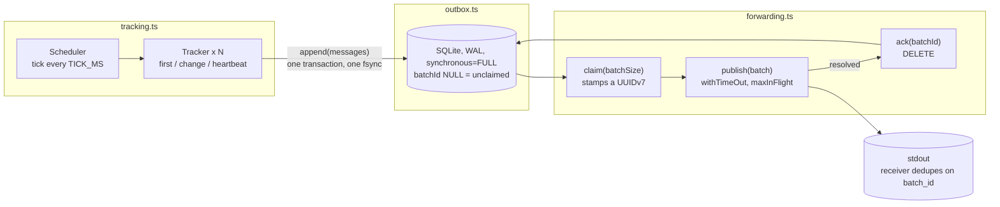

# Telemetry tracker

Samples virtual signals on configured intervals, keeps the samples worth
reporting, stores them durably in a local outbox, and forwards them in batches
over an unreliable channel. The process may be killed at any moment and
restarted; no kept message is lost and none is delivered under two batch ids.

Node.js 24, TypeScript, no runtime dependencies. SQLite comes with Node.

## Running

```bash
npm install            # dev dependencies only: typescript, @types/node
npm start              # node src/main.ts, runs until Ctrl-C
npm test               # node --test, all unit tests, a few seconds
npm run test:crash     # kill -9 the real app five times, then check stdout; ~15 s
npm run typecheck      # tsc --noEmit
npm run check          # typecheck + unit tests
```

stdout carries only batches, one JSON line each. Everything else goes to
stderr. A typical run:

```bash
npm start 2> tracker.log | tee batches.jsonl
```

Node runs the `.ts` files directly (type stripping is on by default in
Node 24), so there is no build step. `tsc` is used only to check types.

### Configuration

`config.json` is the tracker list in the format from the brief:

```json
[
  { "name": "one",   "source": "sin", "sampleMs": 1000, "precision": 0.08 },
  { "name": "two",   "source": "cos", "sampleMs": 2000, "precision": 0.15 },
  { "name": "three", "source": "sin", "sampleMs": 1000, "precision": 5 }
]
```

It is validated at startup: the source must exist, `sampleMs` must be at
least 1000, `precision` must not be negative, names must be unique. Any
violation is fatal, so a bad config never produces a half-running process.

Everything else is an environment variable with a default, so `config.json`
stays exactly the brief's format:

| Variable               | Default            | Meaning                                                  |
|------------------------|--------------------|----------------------------------------------------------|
| `CONFIG_PATH`          | `./config.json`    | tracker list                                             |
| `OUTBOX_PATH`          | `./outbox.sqlite`  | database file (`-wal` and `-shm` files appear next to it) |
| `TICK_MS`              | `100`              | scheduler tick; must be below the smallest `sampleMs`    |
| `HEARTBEAT_MS`         | `15000`            | heartbeat interval from the brief                        |
| `BATCH_SIZE`           | `5000`             | max messages per batch                                   |
| `FORWARD_INTERVAL_MS`  | `10000`            | forwarder tick, also the linger                          |
| `MAX_IN_FLIGHT`        | `1`                | concurrent publishes                                     |
| `PUBLISH_TIMEOUT_MS`   | `5000`             | give up waiting on a publish, retry next tick            |
| `PUBLISH_FAILURE_RATE` | `0.3`              | probability that a publish fails                         |

## Design

Three modules, one process, one thread.



If you know Kafka: trackers are producers, the outbox is a partition log, the
forwarder is a replica fetcher, and the receiver's dedup on `batch_id` plays
the part of the idempotent producer's sequence numbers.

The one invariant everything rests on: **a message gets a batch id exactly
once, in one SQLite transaction, and is only ever published under that id.**
Retries, hung publishes and restarts all resend the same id, which the
receiver collapses. Rows are deleted only after a publish resolved. Those two
facts are the no-duplicates and no-loss guarantees.

### Tracking (`src/tracking.ts`, `src/sources.ts`)

A `Tracker` holds its config and two pieces of state: the last *kept* sample
(value and monotonic time) and the next due time. `sample(wallMs, monoMs)`
returns a `Message` or `undefined`:

- not due yet: `undefined`, nothing else happens
- first sample: kept
- `|value - lastKept.value| >= precision`: kept
- more than `HEARTBEAT_MS` since the last *kept* sample: kept
- otherwise dropped

The heartbeat is measured from the last kept sample, not the last sampled
one, and the boundary is strict: exactly 15 s is not yet a heartbeat.

Two clocks. `ts` and the source input use wall time (`Date.now()`), because
they are data. Due times and the heartbeat use monotonic time
(`performance.now()`), because they are durations. A wall-clock correction
therefore cannot silence trackers, fire every heartbeat at once, or shift the
sampling grid.

The due time advances on the schedule (`nextDueMono += sampleMs` in a loop)
rather than from the actual sample time, so a late tick does not shift later
samples, and a stall longer than one interval skips the missed samples
instead of producing a burst of catch-up samples.

The `Scheduler` runs one `setInterval` at `TICK_MS` and, on each tick:

1. reads wall and monotonic time once, so every message kept in this tick
   carries the same `ts`;
2. compares the monotonic time with where it expected to be and warns on
   stderr if the tick is late, then rebases the expectation so a single stall
   produces a single warning;
3. calls `sample` on every tracker and collects the kept messages;
4. if anything was kept, calls `outbox.append` once. That call is synchronous
   and returns after commit and fsync. If it throws, the tick's messages are
   logged and dropped: they were never in the outbox, which the brief allows.

Why a 100 ms tick and not one timer per tracker: a 1000 ms grid would sample
a 1100 ms tracker up to 999 ms late and alias its interval into ten samples a
second apart followed by a two second gap. Visiting a tracker costs one
comparison, so a 100 ms tick over 1000 trackers is about 10 µs. The price is
up to ten commits per second instead of one.

Sampling is a synchronous loop because reading a source costs microseconds.
If a source were a real sensor read with latency, a different design would be
right: async sources, bounded concurrency, per-sample timestamps, and the
flush behind a barrier. See "Next steps".

Tracking keeps nothing on disk. After a restart every tracker's first sample
is kept, as the brief allows.

### Outbox (`src/outbox.ts`)

One table in one SQLite database, opened with `node:sqlite`:

```sql
PRAGMA journal_mode = WAL;
PRAGMA synchronous = FULL;

CREATE TABLE IF NOT EXISTS outbox (
  seq     INTEGER PRIMARY KEY AUTOINCREMENT,
  name    TEXT    NOT NULL,
  ts      INTEGER NOT NULL,
  value   REAL    NOT NULL,
  batchId TEXT,
  UNIQUE (ts, name)
);
CREATE INDEX IF NOT EXISTS outbox_unclaimed ON outbox (seq)     WHERE batchId IS NULL;
CREATE INDEX IF NOT EXISTS outbox_claimed   ON outbox (batchId) WHERE batchId IS NOT NULL;
```

- `seq` is insertion order, never reused. "Oldest first" means `ORDER BY seq`.
  `ts` would be wrong for this: it is wall time and can jump.
- `UNIQUE (ts, name)` is the brief's message identity. Inserts are
  `INSERT OR IGNORE`, so the same message twice is stored once.
- The two partial indexes are small: one over unclaimed rows for `claim`,
  one over claimed rows for reading and acking batches.

Four operations, all synchronous:

| Call                       | SQL                                                                                     | Transaction                      |
|----------------------------|-----------------------------------------------------------------------------------------|----------------------------------|
| `append(messages)`         | `BEGIN IMMEDIATE; INSERT OR IGNORE … × n; COMMIT`                                       | one per tick, one fsync          |
| `claim(batchSize)`         | `UPDATE outbox SET batchId = ? WHERE seq IN (SELECT seq … WHERE batchId IS NULL ORDER BY seq LIMIT ?)` | single statement, implicit     |
| `unpublishedBatches(limit)`| `SELECT DISTINCT batchId … ORDER BY batchId LIMIT ?`, then rows per id `ORDER BY seq`   | read                             |
| `ack(batchId)`             | `DELETE FROM outbox WHERE batchId = ?`                                                  | single statement, implicit       |

`synchronous = FULL` in WAL mode means every commit fsyncs the log before
returning. That is the durability point: when `append` returns, the rows are
on disk as far as the operating system and the drive honour fsync.
`journal_mode` is stored in the file; `synchronous` is per connection and is
set on every open. SQLite handles torn writes and rollback on reopen, so the
application has no recovery step of its own.

Rows come back as plain `Message` objects. SQLite's row objects have a null
prototype, which is not what callers expect, so they are copied.

The whole API is synchronous and runs on the main thread. At 1000 trackers
that is a few milliseconds of commit per tick, which the scheduler's late-tick
warning would show if it became a problem.

### Batch ids (`src/batchId.ts`)

UUIDv7 per RFC 9562: 48 bits of Unix milliseconds first, big-endian, so ids
sort by creation time as strings, and `ORDER BY batchId` is oldest first with
no extra column. Within one millisecond the 12 bits after the version nibble
are a counter (the RFC's method 1), so ids from one process are strictly
increasing even when several are made in the same millisecond. The first
version without the counter sorted randomly inside a millisecond; the outbox
ordering test caught it.

### Forwarding (`src/forwarding.ts`, `src/withTimeOut.ts`)

The `Forwarder` runs once at `start()` and then every `FORWARD_INTERVAL_MS`.
Each tick:

1. **Claim.** `outbox.claim(BATCH_SIZE)` in a loop until it returns
   `undefined`. Every unclaimed row gets an id within one tick, so the
   forward interval is also the linger. A claim failure is logged and does
   not stop the publish half of the tick.
2. **Fill slots.** `free = MAX_IN_FLIGHT - inFlight.size`. Fetch
   `free + inFlight.size` unpublished batches, oldest first, skip the ones
   already in flight, start at most `free`. Fetching only `free` would return
   exactly the in-flight ones, which are the oldest, and a hung batch would
   starve the ones behind it. There is a test for that.

Each started batch runs `dispatch`, which is the whole life of one attempt:

```
inFlight.add(id)
try    await withTimeOut(PUBLISH_TIMEOUT_MS, publish(batch)); outbox.ack(id)
catch  log "timed out" or "rejected"; leave the rows alone
finally inFlight.delete(id)
```

The tick never awaits anything, so ticks cannot interleave and `inFlight` is a
plain `Set` with no locking. `dispatch` never rejects, so starting it without
awaiting is safe.

`withTimeOut` races the publish against a timer. If the timer wins, the
publish is abandoned but not cancelled (nothing can cancel a promise); a no-op
`catch` is attached so a late rejection is not an unhandled rejection, which
would otherwise exit the process. A late *resolution* is harmless: the retry
has either already acked the batch, making the late ack a no-op, or will.

Failures are retried forever, under the same id, once per tick. There is no
retry cap and no backlog state: a batch that stopped being retried would be a
lost batch, and the brief's failures are random, not permanent.

`stop()` clears the interval and returns. In-flight publishes settle on their
own; whether they ack or not, the outbox is correct, and anything unacked is
resent after the next start.

### Publisher (`src/publisher.ts`)

`publish(batch)` serialises `batch` plus a newline into one string and makes
one `process.stdout.write` call, so concurrent publishes cannot interleave
lines. It resolves when the write has been flushed to the OS. With
probability `PUBLISH_FAILURE_RATE` it instead does one of the brief's three
failures, chosen uniformly: reject without writing, never settle, or write
and then reject. The random source and the output sink are injectable, so
tests can force each mode and never touch the real stdout.

## Guarantees

| Guarantee | Holds because | Does not hold when |
|---|---|---|
| Every message written to the outbox eventually appears on stdout | rows are deleted only in `ack`, after `publish` resolved; retries never stop | the drive lies about fsync (some SD cards and consumer SSDs); the process never runs long enough to drain |
| After dedup on `batch_id`, each message appears once | the id is assigned once, in one transaction, and never reassigned | the receiver does not dedupe on `batch_id` as the brief says it does |
| The outbox is usable after any crash, including mid-write | SQLite WAL with `synchronous=FULL`; partial transactions roll back on open | `outbox.sqlite` is copied without its `-wal` file while the app runs; the filesystem itself is corrupt |
| A sample is taken within `TICK_MS` of its due time | fixed fine tick; due times advance on the grid | a commit or GC pause longer than `TICK_MS`, which is logged on stderr |

Allowed by the brief and by this design:

- Samples kept in memory but not yet committed when power dies are lost.
  They were never in the outbox. With a synchronous `append`, "the tick
  returned" and "the messages are durable" are the same moment.
- `ts` is wall time, so a clock correction shows up as a gap or overlap in
  `ts` on stdout. The sampling schedule itself is unaffected.
- The same message may appear on stdout more than once *before* dedup: a
  publish that wrote and then rejected, a publish that timed out and later
  completed, or an `ack` that failed after a successful publish. All carry
  the same `batch_id`.

## Deviations from the brief

- The forwarder may start up to `MAX_IN_FLIGHT` batches per tick instead of
  exactly one, to drain a backlog after an outage. The default of 1 matches
  the brief literally.
- The forwarder runs once immediately at start, so a backlog after a restart
  does not wait a full interval.
- Sampling runs on a 100 ms tick rather than one timer per tracker, so a
  sample can be taken up to 100 ms after its due time.

## Deliberately left out

- **A worker thread for SQLite.** The main-thread stall is a few
  milliseconds per tick at 1000 trackers. Measure first; the late-tick
  warning is the measurement.
- **Partitions in the outbox.** Nothing to distribute in one process writing
  to one stdout, and every partition would be another fsync.
- **Backoff between retries.** The 10 s tick is the backoff.
- **Retention or an audit log.** stdout is the record. Acked rows are deleted.
- **Config hot reload.** Restart is cheap and loses nothing.
- **Bounding the outbox.** If publishing fails for long enough the database
  grows until the disk is full. The brief asks for no loss, which rules out
  dropping; the honest next step is a disk-space alarm.

## Next steps

- **Work queue instead of ticks in the forwarder.** Refill a slot the moment
  it frees rather than at the next tick. `dispatch`'s `finally` is where that
  one call would go.
- **Async sources with bounded concurrency**, if sources become real sensor
  reads.
- **Metrics on stderr**: event-loop delay, commit latency, batches in flight,
  backlog size.

## Layout

```
src/
  main.ts          wiring and shutdown
  config.ts        config.json validation, settings from the environment
  tracking.ts      Tracker, Scheduler, Clock
  sources.ts       sin, cos
  outbox.ts        Outbox interface, SqliteOutbox
  batchId.ts       uuidv7
  forwarding.ts    Forwarder, Publisher interface
  withTimeOut.ts   withTimeOut, TimeoutError
  publisher.ts     StdoutPublisher with failure injection
  types.ts         Message, Batch
test/
  one file per module, plus smoke.test.ts for the toolchain
docs/superpowers/specs/
  the design spec this was built from
```

Unit tests use no sleeping: a fake clock for the scheduler, Node's built-in
fake timers for the forwarder and the timeout, a scripted publisher whose
promises the test settles by hand, and the real SQLite outbox on a temp file
or in memory.

Two tests run the real process. `test/smoke.test.ts` starts it, lets it run
for two seconds with failures off, stops it with SIGINT and checks both
streams. `test/crash.test.ts` (`npm run test:crash`) is the brief's three
requirements in one place: it `SIGKILL`s the app five times at random
moments, checks `PRAGMA integrity_check` after every kill, records every
message the outbox was ever seen to hold, drains with failures off, and then
asserts over everything that reached stdout that every recorded message is
there, that each `name`+`ts` appears under exactly one `batch_id`, and that
at least one batch was resent, so the retry path really ran.
