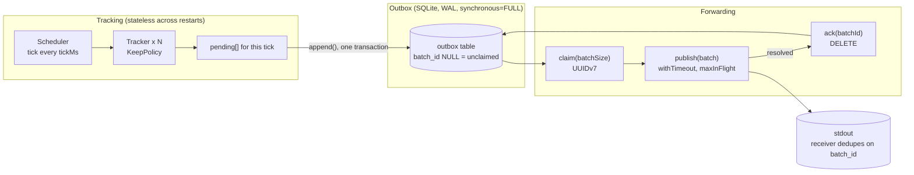
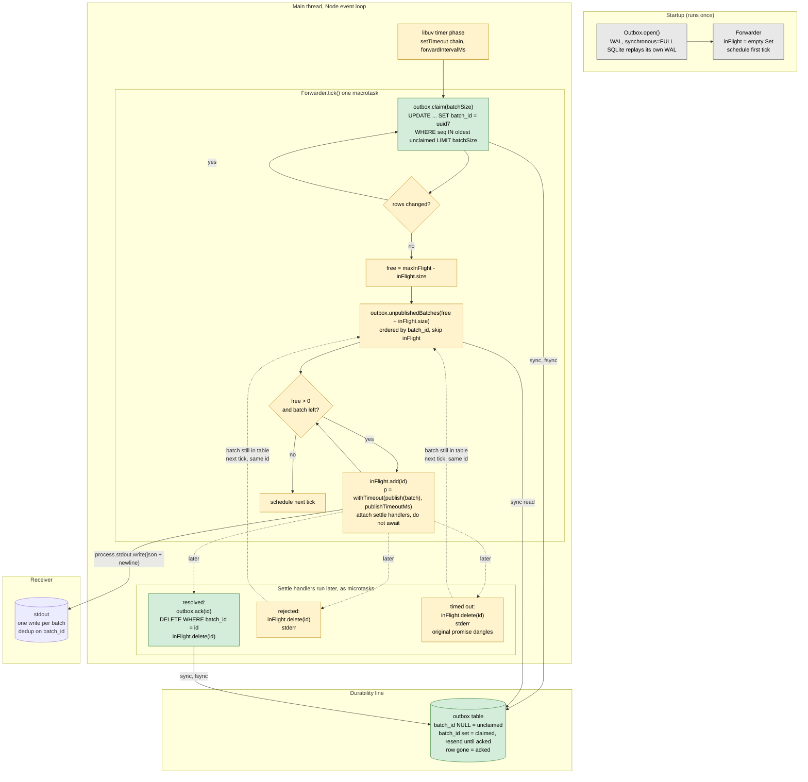
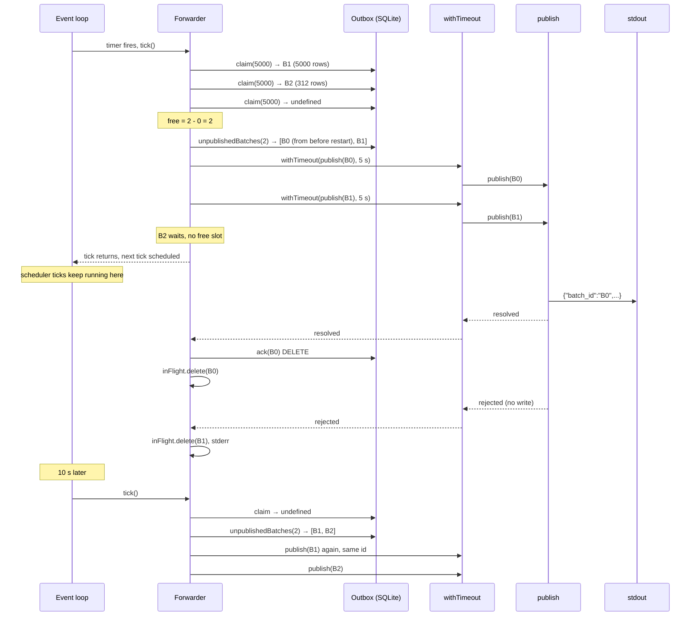
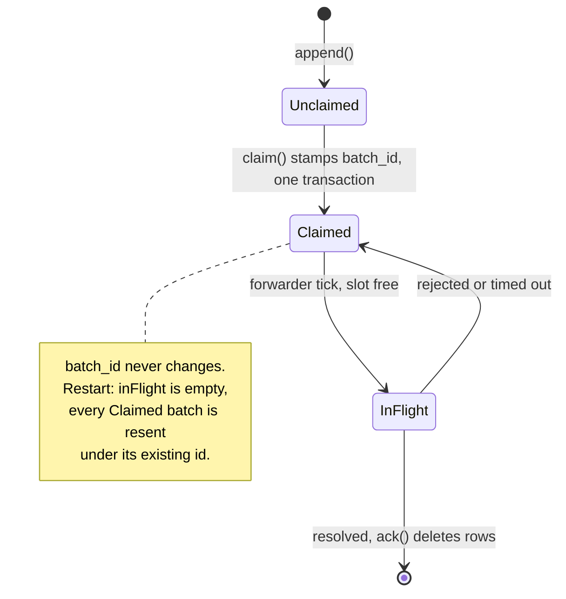

# Durable telemetry tracker: design

Date: 2026-09-29
Status: draft, brainstorming in progress

## 1. Goal

A Node.js 24 / TypeScript application with two stages. Tracking samples
virtual sources on configured intervals, keeps the samples worth reporting,
and writes them durably to a local outbox. Forwarding periodically publishes
the outbox contents in batches over an unreliable channel, which is stdout.
The process may be killed at any moment and restarted. Across any number of
such restarts: no kept message is lost, no message appears on stdout under
two different batch ids, and the outbox stays usable.

Target scale is about 1,000 trackers. The code is for a three hour challenge
and a follow-up walkthrough, so simplicity and explainability win over
throughput.

## 2. Architecture in one paragraph

One process, one thread, one event loop. A scheduler timer samples due
trackers and writes kept samples to a SQLite outbox in a single synchronous
transaction per tick. A forwarder timer claims unclaimed rows into batches,
publishes batches to stdout with a timeout, and deletes the rows of a batch
only after its publish resolved. The batch id is assigned exactly once, in
the claim transaction, and a batch is only ever published under that id.
SQLite provides atomicity and crash recovery. That single invariant plus
retry-forever gives the no-loss and no-duplicate guarantees.

The mental model is Kafka: trackers are producers, the outbox is a partition
log, the forwarder is a replica fetcher, and the receiver's dedup on
`batch_id` plays the role of the idempotent producer's sequence numbers.



## 3. Components

Each component has one job, a small interface, and can be tested alone.

### 3.1 ConfigLoader

Reads `config.json` (the format from the challenge) and validates it: known
`source`, `sampleMs >= 1000`, `precision >= 0`, unique `name`. Any violation
is a fatal error at startup. Application-level settings come from environment
variables with defaults, so `config.json` stays exactly the format the
challenge specifies.

| Variable | Default | Meaning |
|---|---|---|
| `CONFIG_PATH` | `./config.json` | tracker list |
| `OUTBOX_PATH` | `./outbox.sqlite` | database file |
| `TICK_MS` | `100` | scheduler tick, must be below the smallest `sampleMs` |
| `HEARTBEAT_MS` | `15000` | heartbeat interval from the spec |
| `BATCH_SIZE` | `5000` | max messages per batch |
| `FORWARD_INTERVAL_MS` | `10000` | forwarder tick, also the linger |
| `MAX_IN_FLIGHT` | `1` | concurrent publishes |
| `PUBLISH_TIMEOUT_MS` | `5000` | give up waiting on a publish |
| `PUBLISH_FAILURE_RATE` | `0.3` | probability a publish fails |

### 3.2 Source

`type Source = (unixTimeMs: number) => number`. A registry maps `"sin"` and
`"cos"` to the functions from the challenge. Adding a source is adding a map
entry.

### 3.3 Clock

`now(): number` is wall time (`Date.now()`), used for `ts` and as source
input. `monotonic(): number` is `performance.now()`, used for every "how long
since" question: due checks, heartbeat, late-tick detection. Injectable so
tests use a fake clock and never sleep.

Why two clocks: wall time can jump (NTP, operator, boot without RTC). A
backward jump with wall-clock scheduling silences trackers; a forward jump
fires every heartbeat at once; either can mint two messages with the same
`name` and `ts`. Monotonic time has none of these failure modes.

### 3.4 KeepPolicy

Pure function, no state, no clock:

```ts
shouldKeep(value, monoMs, state: { lastKeptValue, lastKeptAtMono } | null,
           precision, heartbeatMs): boolean
```

Keep if there is no state (first sample), or
`Math.abs(value - lastKeptValue) >= precision`, or
`monoMs - lastKeptAtMono > heartbeatMs`.

### 3.5 Tracker

One per config entry. Config: `name`, `source`, `sampleMs`, `precision`.
State: `lastKept: { value, atMono } | null`, `nextDueMono`.

`sample(wallMs, monoMs): Message | undefined`. Reads the source at `wallMs`,
asks `KeepPolicy`, updates `lastKept` on keep, and advances `nextDueMono` by
`sampleMs` on the schedule (not from the actual time) so a late visit does
not shift later samples. If several intervals were missed, `nextDueMono` is
advanced in a loop past `monoMs`; no catch-up samples, since the source only
has the current value.

State lives only in memory. After a restart every tracker's first sample is
kept, as the spec allows.

### 3.6 Scheduler

Owns the trackers, one `setInterval` at `tickMs`, and `expectedMono`.

`tick()`, fully synchronous:

1. `wallMs = clock.now()`, `monoMs = clock.monotonic()`, read once so every
   tracker in the tick gets the same `ts`.
2. If `monoMs - expectedMono` exceeds a threshold, warn to stderr. Then
   `expectedMono = monoMs + tickMs` (rebased on actual time, so one stall
   gives one warning, not a permanent offset).
3. For each tracker with `nextDueMono <= monoMs`: `sample()`, push any
   message onto a local `pending` array.
4. If `pending` is non-empty: `outbox.append(pending)`. Synchronous; returns
   after commit and fsync. If it throws, log to stderr and drop the tick's
   messages. They were never in the outbox, which the spec allows.

Because `append` is synchronous, a tick cannot overlap the next one.
`setInterval` does not stack missed ticks, so a slow commit delays the next
tick rather than queueing work.

Why `tickMs` is 100 and not 1000: a 1000 ms grid samples a 1100 ms tracker
up to 999 ms late and aliases its interval into ten samples one second apart
then a two second gap. Visiting a tracker is one comparison, so a 100 ms tick
costs about 10 microseconds for 1,000 trackers. The cost of the finer tick is
up to 10 commits per second instead of one; at a few milliseconds each that is
about 2% of the loop.

Sampling cost assumption: the loop is synchronous because reading a source is
microseconds. If a source were a real sensor read with latency, a parallel
design would be better: async `Source`, `Promise.allSettled` over due trackers
with a concurrency cap, per-tracker `Date.now()`, and the flush behind a
barrier. Listed under next steps, not built.

### 3.7 Outbox

Wraps one `node:sqlite` `DatabaseSync`. All methods synchronous.

```sql
PRAGMA journal_mode = WAL;
PRAGMA synchronous = FULL;

CREATE TABLE IF NOT EXISTS outbox (
  seq      INTEGER PRIMARY KEY AUTOINCREMENT,
  name     TEXT    NOT NULL,
  ts       INTEGER NOT NULL,
  value    REAL    NOT NULL,
  batch_id TEXT,
  UNIQUE (name, ts)
);
CREATE INDEX IF NOT EXISTS outbox_unclaimed ON outbox (seq) WHERE batch_id IS NULL;
CREATE INDEX IF NOT EXISTS outbox_batch     ON outbox (batch_id) WHERE batch_id IS NOT NULL;
```

| Method | SQL | Notes |
|---|---|---|
| `append(messages)` | `BEGIN; INSERT OR IGNORE ... x n; COMMIT` | one fsync per tick. `OR IGNORE` because the spec identifies a message by `name`+`ts`, so a wall-clock replay is the same message |
| `claim(batchSize)` | `UPDATE outbox SET batch_id = ? WHERE seq IN (SELECT seq FROM outbox WHERE batch_id IS NULL ORDER BY seq LIMIT ?)` | returns the new id, or `undefined` if zero rows changed |
| `unpublishedBatches(limit)` | `SELECT DISTINCT batch_id ... ORDER BY batch_id LIMIT ?` then rows per id ordered by `seq` | UUIDv7 sorts by time, so oldest first |
| `ack(batchId)` | `DELETE FROM outbox WHERE batch_id = ?` | only after publish resolved |
| `close()` | | |

`synchronous = FULL` makes every commit fsync the WAL, which is the
durability point. SQLite handles torn writes, rollback, and WAL recovery on
open, so there is no application-level recovery step.

### 3.8 BatchIdGen

UUIDv7, hand-rolled in about ten lines from `crypto.randomBytes` and
`Date.now()`. Time-ordered, so sorting ids gives insertion order without a
counter to persist.

### 3.9 Publisher

`publish(batch: Batch): Promise<void>` as in the spec. Serialises
`JSON.stringify(batch) + "\n"` into one string and makes one
`process.stdout.write` call, so concurrent publishes cannot interleave lines.

Failure injection: with probability `failureRate`, pick uniformly one of
reject without writing, never resolve, or write then reject. The rate and the
random source are injectable so tests can force each mode.

### 3.10 withTimeout

`withTimeout(promise, ms)`: resolves or rejects with the promise, or rejects
with a `TimeoutError` after `ms`. The original promise is not cancelled; it
may settle later, and its settlement handler must be safe to run late.

### 3.11 Forwarder

State: `inFlight: Set<string>`. Loop: `setTimeout` chain at
`forwardIntervalMs`, never `setInterval`, so a long tick cannot overlap the
next.

`tick()`:

1. **Claim.** `while (outbox.claim(batchSize))`. Claims all full chunks and
   one partial chunk. Every unclaimed row gets an id within one tick, so the
   forward interval doubles as the linger.
2. **Fill slots.** `free = maxInFlight - inFlight.size`. Fetch up to
   `free + inFlight.size` unpublished batches oldest first, skip those in
   `inFlight`, and for each of the first `free`: add to `inFlight`, start
   `withTimeout(publish(batch), publishTimeoutMs)`, do not await.
3. Schedule the next tick.

Settlement, attached to each started publish:

- resolved: `outbox.ack(id)`, remove from `inFlight`.
- rejected: remove from `inFlight`, log.
- timed out: remove from `inFlight`, log. The dangling promise may still
  settle later; a late `ack` on already-deleted rows is a no-op, a late
  stdout write carries the same id and is deduplicated by the receiver.



One tick with `maxInFlight = 2` and three claimed batches:



Batch lifecycle:



### 3.12 Logging

`log.ts` writes to stderr only. stdout is reserved for batches.

### 3.13 main.ts

Load config, open outbox, build trackers, start scheduler and forwarder. On
SIGINT/SIGTERM: stop timers, close the database, exit. No flush-on-exit
logic is needed; everything the scheduler committed is already durable and
the forwarder's next run will resend anything unacked.

## 4. Guarantees and their conditions

| Guarantee | Holds because | Does not hold when |
|---|---|---|
| No loss of any message written to the outbox | rows are deleted only in `ack`, after `publish` resolved; retries never stop | the disk does not honour fsync (some SD cards, consumer SSDs with write cache lies); the process never runs long enough to drain |
| No duplicates after dedup on `batch_id` | `batch_id` is assigned once, in one transaction, and never reassigned | the receiver does not deduplicate on `batch_id` as the spec promises |
| Outbox usable after any crash | SQLite WAL with `synchronous=FULL`; torn writes rolled back on open | database file is copied without its `-wal` file, or the filesystem itself is corrupted |
| A sample is taken within `tickMs` of its due time | fine fixed tick; due times advance on the schedule | a commit or GC pause longer than `tickMs`, which is logged |

Explicitly allowed by the spec and by this design: samples kept in memory but
not yet committed when power dies are lost; they were never in the outbox.
`ts` reflects wall time, so a clock correction shows up as a gap or overlap in
`ts` on stdout.

## 5. Deviations from the challenge text

- The forwarder may launch up to `MAX_IN_FLIGHT` batches per tick instead
  of exactly one, to catch up after outages. The default of 1 matches the
  spec literally.
- Sampling runs on a 100 ms tick rather than one timer per tracker, so a
  sample can be taken up to 100 ms after its due time.

## 6. Testing

No sleeping in unit tests: fake clock, fake timers where needed, and an
injectable random source.

Unit:

- `KeepPolicy`: first sample, boundary at exactly `precision`, heartbeat
  boundary at exactly 15 s, heartbeat measured from last *kept* not last
  *sampled*.
- `Tracker`: due-time advance on schedule, skip-forward after a long stall,
  state reset semantics.
- `Scheduler`: same `ts` for all trackers in a tick, one `append` per tick,
  no `append` on an empty tick, late-tick warning and rebase, `append`
  throwing drops the tick and the next tick still works.
- `Outbox` on a temp file: `append` then `claim` chunking, `claim` returns
  `undefined` when empty, `unpublishedBatches` order, `ack` deletes only that
  batch, `INSERT OR IGNORE` on a repeated `name`+`ts`, reopen sees the same
  rows.
- `withTimeout`: resolve, reject, timeout, late settle after timeout.
- `Forwarder` with a scripted publisher: resolved acks; rejected retries next
  tick with the same id; hung publish times out and retries with the same
  id; `maxInFlight` respected; in-flight ids skipped; write-then-reject
  retried and the receiver sees one distinct id.
- `Publisher`: one write call per batch; each failure mode reachable.

Integration, a crash test that is also the demo:

1. Spawn the app as a child process with a temp outbox and a temp config,
   capture stdout.
2. Repeat N times: run for a random 1 to 15 s, `SIGKILL`, snapshot the
   outbox rows (union across snapshots is the set of messages known to have
   been written), restart.
3. Final run with `PUBLISH_FAILURE_RATE=0` until the table is empty.
4. Assert: every snapshotted message appears on stdout; grouping stdout by
   `batch_id`, every `name`+`ts` pair appears under exactly one id; `PRAGMA
   integrity_check` returns `ok` after every kill.

Tooling: `node --test` with Node 24's built-in type stripping, so tests and
app run without a build step. `tsc --noEmit` for type checking. Dev
dependencies only: `typescript`, `@types/node`.

## 7. Deliberately left out

- A worker thread for SQLite. The stall is a few ms per tick at 1,000
  trackers; measure first, move if the numbers say so.
- Partitions in the outbox. Nothing to distribute in one process writing to
  one stdout; every partition would be another fsync.
- Backoff between retries. The 10 s tick is the backoff.
- Retention or an audit log. stdout is the record.
- Config hot reload. Restart is cheap and loses nothing.

## 8. Next steps for the follow-up

- Work queue in the forwarder: refill a slot the moment it frees instead of
  waiting for the next tick.
- Async sources with bounded concurrency.
- Event-loop delay and commit-latency metrics on stderr.

## 9. Project layout

```
telemetry-tracker/
  package.json  tsconfig.json  config.json  README.md
  src/
    main.ts  config.ts  clock.ts  sources.ts  keep-policy.ts  tracker.ts
    scheduler.ts  outbox.ts  batch-id.ts  publisher.ts  with-timeout.ts
    forwarder.ts  log.ts  types.ts
  test/
    *.test.ts   one per module, plus crash.test.ts
  docs/superpowers/specs/2026-09-29-telemetry-tracker-design.md
```
